# 魔法商店 · Magic Shop

一间开在 DSH 侧边的小店：你是店主，柜台后面站着一个会数铜板的人。客人推门、指货、付钱，货架空了去后屋补，天黑打烊，第二天接着开。你干你的活，它自己过日子。

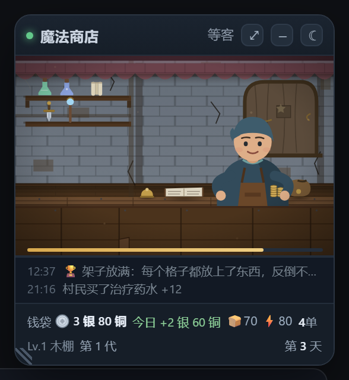

**界面**：右侧常驻一张 268px 的小卡片——上半是纯 SVG 画的小店（窗、柜台、货架、店主、客人），下半是钱袋、货架与今日流水。卡片左侧的斜纹可以拖宽（220–760px，松手记住）；标题栏的 `⤢` 把卡片展开成两栏大窗，左场景右账本，按 `Esc` 收回。标题栏最右的 `☾` 关掉整张卡，屏幕右下角留一颗 44×44 的小月亮，点它叫回来。

| 大窗 · 资助 | 大窗 · 成就 |
| --- | --- |
| 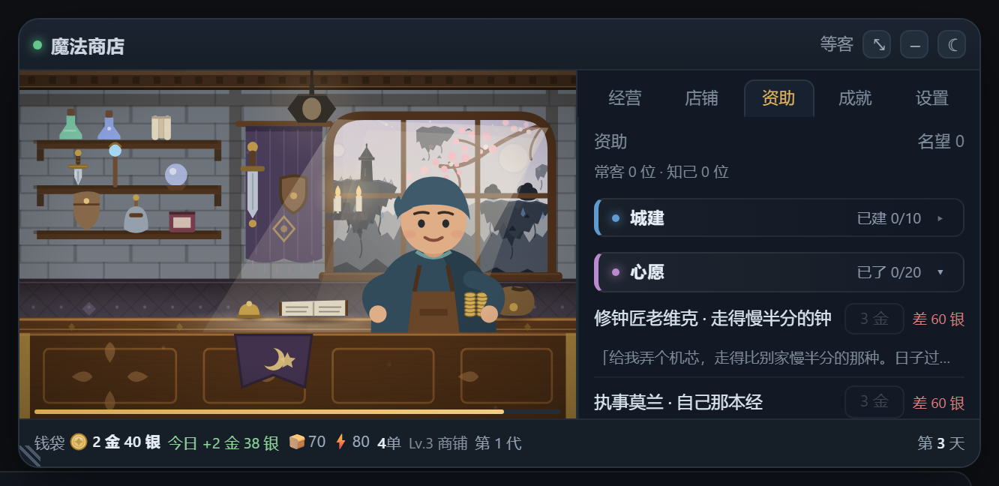 | 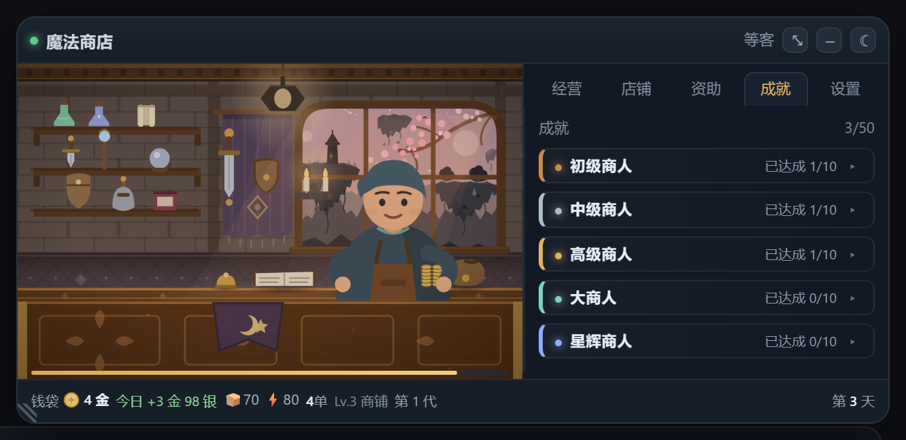 |

| 法阵充能 | 传承 |
| --- | --- |
| 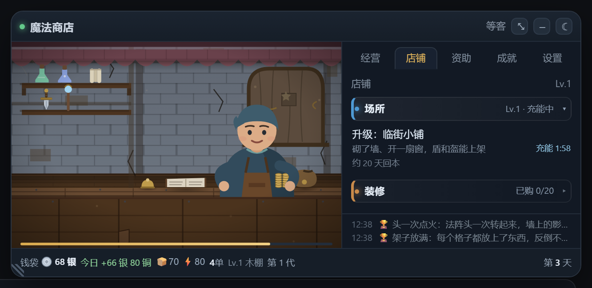 | 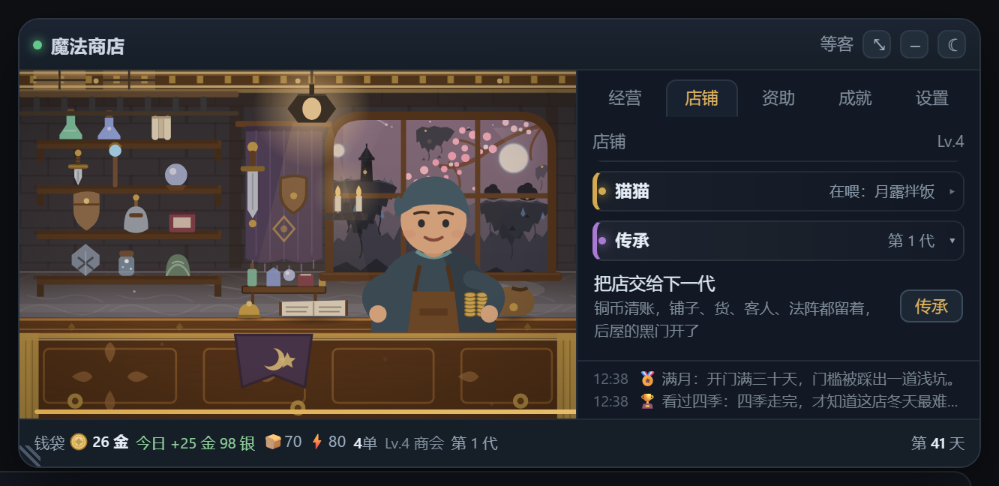 |

| 店铺 · 猫猫 | 打烊小结 |
| --- | --- |
| 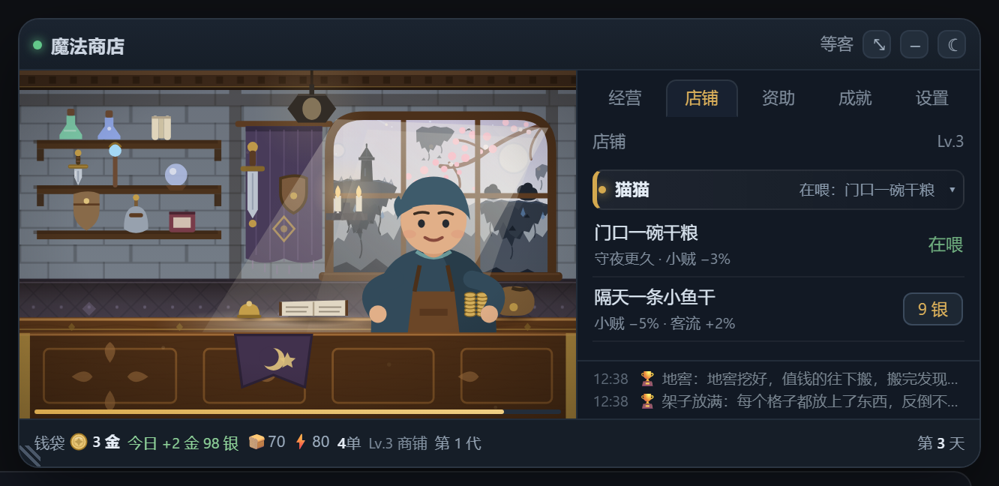 |  |

| 伙食 · 价钱写在按钮上 | 经营 · 钱都从哪来 |
| --- | --- |
| 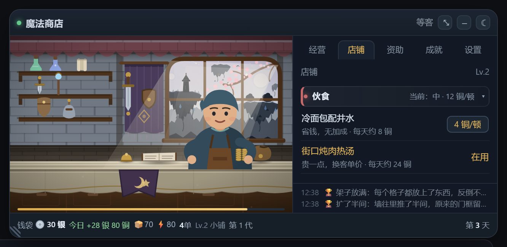 | 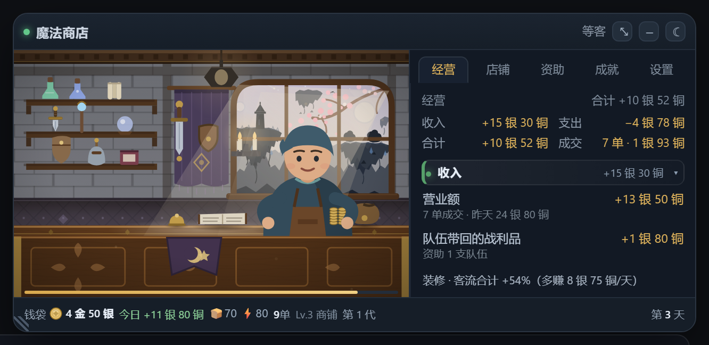 |

| 资助 · 冒险队（持续花钱的地方） | 支出 · 收起来只看总数 |
| --- | --- |
| 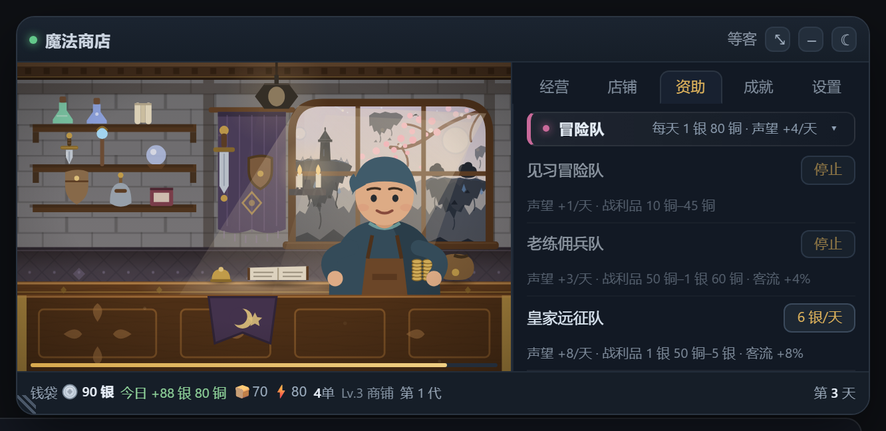 | 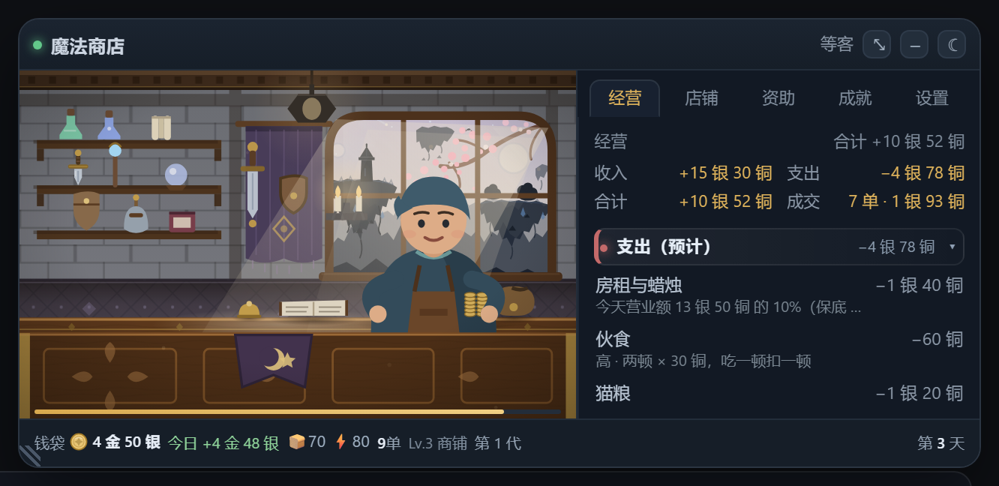 |

| 头三步 | 星砂集市 |
| --- | --- |
| 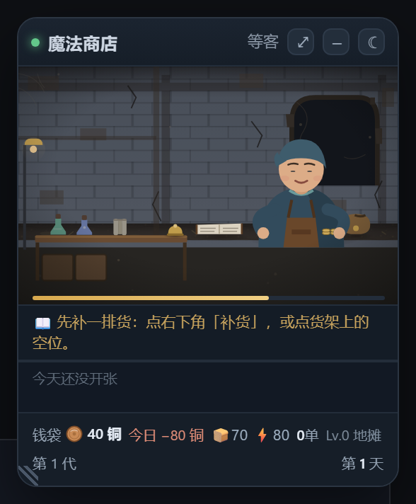 | 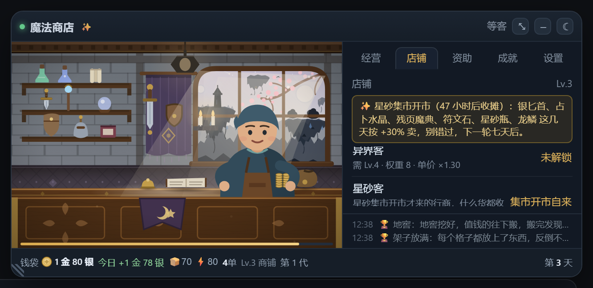 |

关店之后，它就安静地待在屏幕角落：


## 安装

**插件市场**：在 DSH 的插件市场里搜索「魔法商店」或 `dsh-game-magic`，安装后启用，刷新页面。

**本地安装**（想自己改代码时）：

```bash
# 把插件装进当前 DSH profile，路径换成你的插件目录或包名
npm install <path-to-dsh-game-magic>
```

再把 `"dsh-game-magic"` 加进该 profile `package.json` 的 `dsh.profile.bundles`，重启 DSH。插件零第三方依赖，纯 DOM + SVG，装好即用。

## 怎么玩

### 卡片与大窗

小卡用来瞄一眼：钱袋、货架还剩几件、最近两条流水。想看细节就 `⤢` 展开：左边是店里的实景，右边五个页签——经营、店铺、资助、成就、设置（经营排第一，进门先看账）。店铺页按场所、装修、渠道、顾客、伙食、猫猫、传承分成七组，每组是一条带颜色的标签条，点一下就展开或收起；猫猫单独一栏养着三档粮。经营页进门就是一本当天的总账：收入多少、支出多少、合计剩多少（倒贴就是负号），收入与支出各是一条可折叠的标签条，点开才看细账——收入里是营业额和冒险队带回的战利品，支出里是房租蜡烛、两顿饭、资助的队伍和补货钱；下面再接装修逐件多挣多少、已投入多少、按现在的盈利几天回本，以及最近七天的营业额。资助页分三栏：城建（十处，谁先建由你挑）、心愿（二十件常客的私事）、冒险队（三支按天收费的队伍）；成就按初级、中级、高级、大商人、星辉商人五段排，每段十项。收起的习惯会记在存档里。拖标题栏可以挪位置，双击标题栏进安静模式，不再冒气泡。

### 头三步

第一次开店，卡片底部会依次说三句话：先补一排货、等第一位客人推门、打烊时看两行小结。走完一遍就不再出现，也不拦你点任何东西；想再走一遍（或者想彻底关掉）去设置页，那里有一个开关。

### 一天怎么过

一天等于 12 分钟真实时间。7:00 开门，24:00 打烊；营业时客人陆续进来，打烊后店主数钱、守夜、补货。窗外的光跟着真实钟点走：白天斜射的日光、黄昏偏暖、夜里只剩吊灯和月亮。你不在的时候店里照常开着一点，回来翻流水就知道这几天发生了什么。

经营页把一天的账摊开：最上面是收入、支出、合计，收入与支出各是一条可折叠的标签条。收入是已经进账的钱（营业额 + 队伍带回来的战利品），支出是**按你现在的样子预估今天会花多少**——房租按今天的营业额现算、伙食是两顿、猫粮是你今天换的那袋、资助按天、补货按货架估。换伙食档、雇一支队伍、买一袋猫粮，这几个数字当场就动，不用等日结。

### 客人

村民、佣兵团、盗贼、法师、贵族，以及后面才会出现的灵体客。有人一次只买一件，有人成批抓货，也有人只认贵的；招呼、报价、收钱、离开各是一小段动作，能看到他抬手、翻账本、柜台上闪一下钱光。夜里偶尔来个商队或小贼——养只店猫能让它少得手几次。

### 星砂集市

每七个真实天开一次，一次四十八小时。开市那两天门口挂着横幅、客流多两成半，货架上有六件货按 +30% 收，还会多一种只在集市出现的「星砂客」——什么货都收，出手比村民阔。开市时店名旁会多一枚 ✨，店收起来时右下角的小月亮会镀一圈金，关着店也不会错过。摊子收了你才知道错过，但也不罚：等下一轮就是。

### 货品、装修与渠道

场所等级决定「哪些货有资格上架」，每件货还要单独花钱解锁；锁着的货不会出现在场景、成交和补货里。货架见底按件补货，钱实在不够时后屋会翻出一件旧货，店不会停摆。每天开市随机一件在架货涨价或跌价，只当天有效。

装修是买断制：一件拉客流，一件抬客单价或扩库存，一件管风险或后勤，买过就不会因为改价被回收。进货渠道按货类加价——兵刃盾盔、药水卷轴、法器异材各有各的路子。

摆设的加成是收敛的：单件只加 2%–16%，全部二十件买齐，客流约多八成半、客单价多七个百分点，不会出现「越买越滚、第二天就回本」。价钱按「八到十二天回本」定，买第几件都不吃亏——加成不看顺序，只看你买了哪些。到底值不值，翻到「经营」页，每一件旁边都写着它今天替店里多挣了多少。

### 钱花在哪：资助冒险队

店里的钱大多只进不出，久了就没处花。资助页的「冒险队」是唯一一门会持续亏损的生意：三支队伍按天收费，每天日结时自动扣，换来声望，运气好时队伍带回一点战利品，带客流的两支还会让门口多几个人。期望回收刻意定得比支出低——这笔钱买的是名声，不是利润。

钱袋付不出当天那一笔时，队伍会自动散掉，不会像房租那样滚成欠账；想停也随时能停，点一下「停止」第二天就不再扣。声望在资助页有它的用处，也是成就里的一条线。

### 店主吃什么，猫吃什么

店主一天两顿，省钱、家常、讲究三档随你切：没选的那两档，按钮上直接写着这一顿多少钱，点一下就换，钱按顿扣。养了店猫之后，「猫猫」一栏也有三档粮：门口一碗干粮、隔天一条小鱼干、月露拌饭——三档不排队，谁都能直接喂，换一档就是重新买一袋（价钱就写在按钮上），越往后小贼越难得手、猫越会揽客。

### 三档货币

铜、银、金，100 进制：100 铜 = 1 银，100 银 = 1 金。显示最多三段，最高位一定出现，低位只在非零时露头。

### 房租与欠账

每次跨天先付账：按当日营业额抽成，外加一点蜡烛钱。付不出就记账，卡片底部出现「欠 N」；连续欠账，次日门上挂木牌，歇业一天。

### 他也要吃饭睡觉

饿了干不动活，体力见底会趴下睡一会儿，醒来接着招呼。

## 为什么它适合挂在旁边

- **不抢焦点**：不弹窗、不发通知、不切页面；卡片就贴在右侧，你打字时它不挡。
- **关掉即暂停**：点 `☾` 之后经济停在那一刻，不进货、不卖货、不结算；`Esc` 只是收回大窗，店照常营业。
- **不打扰工作**：一天 12 分钟，想起来点两下就有进展，没有打卡任务，也不联网；挂着只重画你正在看的那一页，一天下来也不烫手。
- **记得住你的习惯**：宽度、位置、开关状态都存档，刷新和换窗口都还在原处。

## 成长节奏

- **开头几分钟**：攒够第一件东西的钱，货架多出一格，第一次看到解锁按钮亮起来。小卡底部会给三步提示——先补货、等第一位客人、打烊看小结；走完就不再出现，设置页里可以关。
- **店里会真的变满**：买下的摆设会出现在店景里，包括旧账本、门边盐线、门口油灯、迎客草席、蒙尘穿衣镜、停摆座钟、地窖暗门这七件。
- **中期**：想再往上走得给店里的法阵充能，充能按真实时间推进，急不来——正好去干别的，回来刚好。
- **第七天**：可以开启「传承」，带着这一轮攒下的家底进入第二轮；第二轮解锁禁忌货品、黑市与灵体客，货架和客人都换一批。传承时可以留一样天赋给下一位店主，六样里挑一：人流、定价、法阵、运气、铺租、货源——分别管客流、售价、充能、战利品、房租和补货，二周目的路数从这里岔开。
- **更后面**：星砂集市开张，季节限定货随四时轮换，窗外的天光和街景也跟着变；传承页里会多一行「这一脉」，记着第几代、禁忌货开了几件、赶过几回集。

数值还在调，这里只写机制与手感，具体以游戏内为准。

## 存档与兼容

- **双写**：localStorage 一份，DSH 同源存档接口一份（落在本机 DSH 数据目录）。换端口、清缓存、卸载重装，只要磁盘那份还在，档就还在。
- **不会互相盖**：两份存档带写入时间与序号，慢半拍的窗口会被拒写，不会把新档顶回旧档。
- **版本**：需要 DSH `>=0.2.1-rc.2 <0.4.0`；更老的宿主会退化成只写 localStorage，游戏照常能玩。
- **换设备**：设置页有「复制存档码」，一点就把整档压成一行字送进剪贴板，粘到另一台机器的「导入」里就能接着开；浏览器不给剪贴板时会自动展开存档让你手动全选。
- **清零**：大窗 →「店铺」页最底下的「重新开始」，两段点击确认，不弹任何对话框。

## 许可

BSD-3-Clause，全文见 `LICENSE`。

## English

Magic Shop is a small idle game that lives in the DSH sidebar. You run a medieval shop: customers walk in, point at an item, pay, and leave; shelves restock themselves, the day ends, and the next one begins. It keeps running while you work.

A 268px card sits on the right (drag its edge to resize), `⤢` expands it into a two-column window, `Esc` collapses it, and `☾` hides it entirely, leaving a small moon in the corner — with the economy paused until you bring it back. Time is measured in 12-minute days with a 7:00–24:00 opening rhythm, three currencies (100 copper = 1 silver, 100 silver = 1 gold), rent, meals, and a shop that grows from a street stall into a guild storefront. The ledger tab comes first and shows exactly where the money comes from: today vs yesterday, orders, average basket, and how much each piece of decor adds every day. Inside the window everything is foldable: upgrades split into place, decor, suppliers, customers, sponsored adventuring parties, meals (plus three grades of cat food) and legacy; twenty regulars' wishes and fifty achievements grouped in five merchant ranks each fold away with a click. Sponsoring a party is the one steady money sink — it costs coin every day and pays back in renown (and the occasional loot), never in profit.

Saves are written both to localStorage and to a DSH-hosted save route, so switching ports or reinstalling does not lose your shop. Requires DSH `>=0.2.1-rc.2 <0.4.0`. Licensed BSD-3-Clause.
